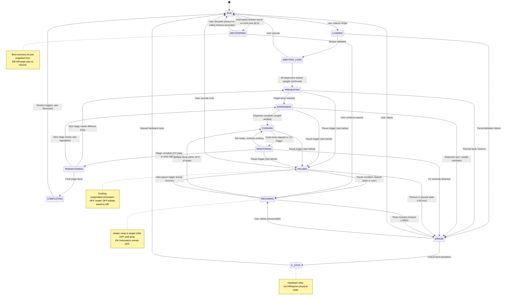

# Main Loop State Machine

This document describes the main cooking loop state machine and how each state drives behavior across the three system layers: **UI** (LVGL touchscreen), **Controller** (Recipe Engine on RV1106), and **Driver** (STM32 FreeRTOS).

> [!note] Related
> See [[02-Controller-Software-Architecture|Controller Software Architecture]] for the overall dual-processor design, recipe YAML format, and CV pipeline details.

---

## 1. State Diagram



---

## 2. State-Layer Impact Table

| State | UI (LVGL) | Controller (RV1106 Recipe Engine) | Driver (STM32) |
|-------|-----------|-------------------------------|----------------|
| **IDLE** | Recipe browser, cook history, settings, battery indicator | Waiting for recipe selection; dock monitor tracks docked / mains / state of charge | TELEMETRY at 20 Hz, HB_AP watch, safety idle checks; Q_DOCK on while DOCK_SENSE_B is low |
| **LOADING** | "Validating recipe..." spinner | Parse YAML, resolve ingredient list, check dispenser mapping | No change from IDLE |
| **AWAITING_LOAD** | Checklist UI: "Lift the unit, load onions in CID Slot1 ✓", live weight readout per slot, "Re-dock to continue" | Read the SLD load cells in-process (`QUERY_WEIGHT` / `DISPENSER_STATUS` to the dispense thread, NAU7802 over I2C3), compare against recipe requirements; wait for DOCK_SENSE_A to read docked again before PREHEATING | Safe hold while the DU is lifted (DOCK_SENSE_B open); back to IDLE behaviour once re-docked |
| **PREHEATING** | Progress bar (current temp → target), ETA countdown | Set the heat thread setpoint (target, ramp_rate); the heat thread sends HEAT_SET_TEMP over CAN (2 Hz keep-alive) and the module regulates; read surface_temp from HEAT_STATUS | Monitor HEAT_STATUS for limits; stir motor parked |
| **DISPENSING** | "Dispensing oil (30 g)..." with live weight bar | Queue `DISPENSE_SLD(channel, target_g)`, `DISPENSE_CID(slot)` or `DISPENSE_FID(box, qty)` to the dispense thread (in-process, same names as the former CAN block), wait for its ACK, monitor weight convergence from the NAU7802 | Not involved — dispensing is local to the Dispensing Unit; stir motor holds its current setpoint |
| **COOKING** | Timer countdown, live temp graph, stir pattern indicator | Send `SET_STIR(pattern, speed)`, maintain temp setpoint, trigger CV capture at 2 Hz | Stir pattern execution on the CAN servo, report telemetry (the module holds temperature) |
| **MONITORING** | CV confidence overlay on camera feed, "Analyzing..." indicator | Run RKNN inference on the NPU for the latest ISP self-path frame, evaluate `cv_check` condition, apply timer fallback | Continue current stir setpoint unchanged (the module holds temperature) |
| **TRANSITIONING** | "Stage 3/6 complete — next: Add Dal", brief animation | Compute next stage parameters from YAML, update the heat setpoint, queue `DISPENSE` commands to the dispense thread | Stop or change stir pattern |
| **COMPLETING** | "Cooking Complete!" summary card, rating prompt, share option | Log session to SQLite, publish MQTT `cook/complete`, compute nutrition estimate | Stir OFF (motor parked, 24 V off after 60 s), exhaust fan cooldown ramp (RV1106 sends HEAT_ON_OFF 0) |
| **RECOVERING** | Boot recovery dialog: "Previous cook interrupted — Resume {recipe_name}? Stage {n}/{total}, {elapsed} elapsed" with [Resume] and [Discard] buttons; shows time since power loss | On boot, query `cooking_sessions` for `status IN ('paused', 'cooking', 'started')` on this appliance. If found: load pause snapshot from `stages_log`, validate recipe still exists, check elapsed time since `paused_at` against 30-min food safety limit. If valid → show prompt. If expired → auto-discard and mark session `aborted` | TELEMETRY at 20 Hz once docked with mains, stir OFF, heater OFF; the surface temperature shown by the UI comes from HEAT_STATUS |
| **PAUSED** | Pause overlay showing reason (power loss / unit lifted / sensor fault / heater error / user), elapsed pause timer, cancel button; resume button enabled only when condition cleared | Suspend stage timer, save cooking state snapshot to SQLite (stage index, elapsed time, setpoints, pause reason), hold setpoints in memory, log pause event with telemetry; the dispense thread drops the 6V_DSP rail, solenoids and pumps | Stir motor disabled; RV1106 sends HEAT_ON_OFF 0, STM32 forces HEAT_ON_OFF=0 on a fault pause; exhaust fan continues at idle (25%) while mains is present; safe hold (Q_STIR, Q_DOCK off) if the DU is lifted |
| **RESUMING** | "Resuming — Heating to {target}°C" with live temp progress bar, stir/dispense paused indicator | Restore the heat thread setpoint (saved_target, ramp_rate), read HEAT_STATUS surface_temp, wait for it within ±5°C of target for 3 consecutive readings, then transition to COOKING with restored stage timer | Stir OFF (resumes on COOKING entry), actuators OFF, report telemetry (the module ramps itself to the saved target) |
| **ERROR** | Error description banner, retry / skip stage / abort buttons | Classify error (recoverable vs critical), determine recovery options, log to DB; the dispense thread stops any dispense in progress | Depends on error: stop stir, or hold safe state |
| **E_STOP** | Full-screen red alert: "Emergency Stop — Reset Required"; buzzer on the Dispensing Unit | Log event with full telemetry snapshot, sound the buzzer (RV1106 PWM), await manual reset | Cut heater relay (hardware), disable stir motor and its 24 V, all outputs safe |

---

## 3. Sequence Diagram: Single Cooking Stage

The following shows message flow for a typical "Add Spices" stage from the Dal Tadka recipe (stage 3: add cumin seeds to hot oil).

```mermaid
sequenceDiagram
    participant UI as UI (LVGL)
    participant RE as Recipe Engine
    participant DT as dispense thread (I2C3)
    participant BR as can thread (can0)
    participant HT as heat thread
    participant MC as STM32 (CSC, FreeRTOS)
    participant HM as Heating Unit MCU

    RE->>RE: Load stage 3 from YAML
    RE->>UI: state=DISPENSING, msg="Dispensing cumin (5g)"

    RE->>DT: DISPENSE_FID(box=1, qty_quarter_tsp=4)
    DT->>DT: 6V_DSP on, index box 1 (PCA9685), open gate, 4 dose strokes, rail off
    DT-->>RE: dispense_ack(doses=4, est_mass=2.7g)

    RE->>RE: All doses delivered → OK
    RE->>UI: state=COOKING, msg="Cooking 45s at 180°C"

    RE->>HT: setpoint(180)
    HT->>HM: CAN 0x100 HEAT_SET_TEMP (2 Hz keep-alive; module PID)
    RE->>BR: SET_STIR(pattern=CIRCULAR, speed=40)
    BR->>MC: CAN 0x202 [seq, pattern=CIRCULAR, speed=40, dir=CW]
    MC->>MC: Stir pattern running

    loop Every 500ms
        HM-->>BR: CAN 0x180 HEAT_STATUS [surface_temp=178.0, pot=1]
        MC-->>BR: CAN 0x310 TELEMETRY [rpm=40, current=0.8A, state=NORMAL]
        BR-->>RE: telemetry(temp=178, rpm=40)
        RE->>UI: update temp graph
    end

    RE->>RE: Timer=45s elapsed
    RE->>UI: state=MONITORING, msg="Analyzing..."

    RE->>RE: Grab ISP self-path frame, run RKNN inference on NPU
    RE->>RE: cv_result=cumin_toasted (confidence=0.87)

    RE->>UI: state=TRANSITIONING, msg="Stage 3/6 done — next: Add onions"
    RE->>HT: setpoint(160)
```

---

## 4. Transition Trigger Table

| From | To | Trigger | Details |
|------|----|---------|---------|
| IDLE | LOADING | User action | User taps recipe and confirms "Start Cook" |
| LOADING | AWAITING_LOAD | Validation pass | YAML parsed, all ingredients mapped to dispensers |
| LOADING | ERROR | Validation fail | Missing ingredient, unsupported dispenser, corrupt YAML |
| AWAITING_LOAD | PREHEATING | Weight confirmed | DU re-docked (DOCK_SENSE_A low) and all required dispenser slots report weight ≥ recipe minimum (NAU7802 via the dispense thread) |
| AWAITING_LOAD | IDLE | User cancel | User taps "Cancel" before loading |
| PREHEATING | DISPENSING | Temp threshold | Module surface_temp (HEAT_STATUS) within ±5°C of stage target for 3 consecutive readings |
| PREHEATING | ERROR | Timeout / fault | Temp not reached within `preheat_timeout` (default 300 s) or CAN element over-temp |
| DISPENSING | COOKING | Weight converged | Load cell delta matches target ±10%, or fixed dispense time elapsed |
| DISPENSING | ERROR | Jam / mismatch | No weight change after actuation, or weight exceeds 150% of target |
| COOKING | MONITORING | Timer / CV | `duration_seconds` elapsed, or periodic CV check interval reached |
| COOKING | PAUSED | Pause trigger | See [[#Pause Triggers]] below |
| PREHEATING | PAUSED | Pause trigger | See [[#Pause Triggers]] below |
| DISPENSING | PAUSED | Pause trigger | See [[#Pause Triggers]] below |
| MONITORING | PAUSED | Pause trigger | See [[#Pause Triggers]] below |
| MONITORING | TRANSITIONING | Stage complete | `cv_check` condition met (confidence ≥ threshold) or timer fallback expired |
| MONITORING | COOKING | Not ready | CV confidence below threshold, resume cooking with same setpoints |
| MONITORING | ERROR | CV anomaly | Anomaly detected (e.g., smoke, empty vessel, unexpected color) |
| TRANSITIONING | PREHEATING | Temp change needed | Next stage `temp_target` differs by >10°C from current |
| TRANSITIONING | DISPENSING | New ingredients | Next stage has `ingredients` list to dispense |
| TRANSITIONING | COMPLETING | Last stage | No more stages in recipe YAML |
| COMPLETING | IDLE | Session end | Log written, user dismisses summary or 5 min auto-return |
| IDLE | RECOVERING | Boot recovery | On system boot, Recipe Engine queries `cooking_sessions` for rows with `status IN ('paused', 'cooking', 'started')` and `appliance_id` matching this device. If an interrupted session exists and was paused less than 30 min ago, transition to RECOVERING to prompt the user |
| RECOVERING | RESUMING | User confirms | User taps "Resume" on the boot recovery dialog. Recipe Engine restores the pause snapshot (stage index, elapsed time, temp target, stir pattern) from `stages_log` and transitions to RESUMING to ramp the surface back to the saved target temperature |
| RECOVERING | IDLE | User discards or timeout | User taps "Discard" or the 30-min food safety window has already elapsed. Session is marked `status = 'aborted'` with `notes = 'Discarded after power loss recovery'`. System returns to IDLE |
| PAUSED | RESUMING | Condition cleared | Pause condition resolved: mains restored (DOCK_PWR_OK active and TELEMETRY back from the STM32 for 2 s), sensor/actuator fault cleared (healthy telemetry / dispense-thread status for 3 consecutive readings), heater error cleared (CAN status OK), or user taps "Resume" (manual pause, and UNIT_LIFTED once DOCK_SENSE_A reads docked again). Auto-resume if pause duration <5 min; user prompt if >5 min |
| PAUSED | IDLE | User cancel | User taps "Cancel Cook" during pause |
| PAUSED | ERROR | Pause timeout | Paused longer than 30 min without action |
| RESUMING | COOKING | Temp recovered | Module surface_temp within ±5°C of saved stage target for 3 consecutive readings (same criteria as PREHEATING → DISPENSING). Stage timer resumes from saved elapsed value. Stir pattern restored on entry to COOKING |
| RESUMING | PAUSED | New pause trigger | A new pause condition occurs during temperature recovery (e.g., power fails again during ramp-up) |
| RESUMING | ERROR | Recovery timeout | Surface temp does not reach target within 300s (5 min) of ramp start — indicates possible heater or sensor fault |
| ERROR | IDLE | User abort | User taps "Abort" — session logged as incomplete |
| ERROR | RESUMING | User retry | Recoverable error — user taps "Retry", controller enters RESUMING to re-establish temperature before resuming cook |
| ERROR | E_STOP | Critical fault | Thermal runaway, CAN bus failure, or repeated unrecoverable error |
| E_STOP | IDLE | Hardware reset | Physical reset button pressed, watchdog confirms safe state |

---

## 5. Pause Triggers

Any active cooking state (PREHEATING, DISPENSING, COOKING, MONITORING) can transition to PAUSED when one of the following conditions is detected. The pause reason is stored in the cooking state snapshot to determine the appropriate resume behavior.

| Trigger | Source | Detection | Auto-Resume? | Details |
|---------|--------|-----------|-------------|---------|
| **AC Power Failure** | RV1106 dock monitor (DOCK_PWR_OK GPIO) | DOCK_PWR_OK goes inactive while DOCK_SENSE_A says docked, confirmed by TELEMETRY timeout (300 ms) | Yes, if <5 min | Mains to the Cooking Surface is gone, so the heater, stir motor and STM32 are already down with the base. The Dispensing Unit keeps running on its 2S pack (the primary supply, > 5 h at ≈ 3 W): the RV1106 saves state to SQLite and shows the battery indicator. When TELEMETRY returns (the STM32 reboots in < 1 s after mains returns) auto-resume to RESUMING if the pause is < 5 min, prompt if < 30 min, ERROR beyond (food-safety rule unchanged). Battery: warning banner at 6.4 V; at 6.2 V checkpoint + halt → RECOVERING on next power (§5.3); pack PCM cut-off ≈ 5.6 V as last resort |
| **Unit Lifted** | RV1106 GPIO edge (DOCK_SENSE_A) | DOCK_SENSE_A high — the dock pads are open | No — user tap after re-docking | The Dispensing Unit has been lifted off the Cooking Surface: the CAN bus and DOCK_24V open at the same instant. The heater stops ≤ 1 s by keep-alive loss, the STM32 enters safe hold on DOCK_SENSE_B (HEAT_ON_OFF 0, stir disable, Q_STIR and Q_DOCK off, STATUS DU_UNDOCKED). The RV1106 runs on its pack, pauses with reason UNIT_LIFTED and shows "Re-dock to continue". Resume only when DOCK_SENSE_A reads docked again and the user taps "Resume" (no auto-resume); same 30 min food-safety ceiling |
| **Sensor Malfunction** | RV1106 dispense thread / HEAT_STATUS | Module surface_temp out-of-range (< -10°C or > 400°C) or module sensor fault flag, load cell NAU7802 I2C NACK or no data-ready, INA219 I2C NACK | No — user prompt | Sensor data unreliable. RV1106 identifies which sensor failed. Cooking cannot safely continue without correct readings. User prompted to check the connection and tap "Resume" |
| **Actuator Malfunction** | STM32 STATUS (stir) / RV1106 dispense thread (dispensers) | STIR_STALL from the CAN servo (reported current above limit with velocity error), STIR_CAN_FAULT (no motor feedback), DSB_STALL detected by the dispense thread (INA219 #1 current > 2.5 A for 300 ms, 3 s move timeout or I2C NACK after one retry while indexing a carousel or dosing), peristaltic pump no flow (no NAU7802 weight delta after 5s of actuation, dispense thread) | No — user prompt | Actuator failed to perform expected action. RV1106 logs fault details. User prompted to inspect actuator and tap "Resume" |
| **Heating Unit Error** | CAN bus (HEAT_STATUS / HEAT_FAULT, read by the RV1106) | HEAT_FAULT received, fault_flags in HEAT_STATUS (overcurrent, element over-temp, relay/triac or sensor failure), or no HEAT_STATUS for >500 ms | Depends on fault | Transient faults (e.g., CAN timeout, momentary overtemp): auto-retry once after 5s, then pause. Permanent faults (power-stage or sensor failure): pause and prompt user. CAN bus offline: pause immediately |
| **User Pause** | UI touch event | User taps "Pause" button on cooking screen | No — user must tap "Resume" | Manual pause for lid check, ingredient addition, etc. |

### 5.1 Pause State Persistence

On entering PAUSED, the Recipe Engine saves a snapshot to SQLite:

```json
{
  "session_id": "uuid",
  "pause_reason": "POWER_FAILURE | UNIT_LIFTED | SENSOR_FAULT | ACTUATOR_FAULT | HEATER_ERROR | USER_PAUSE",
  "paused_at": "2026-02-20T14:30:00Z",
  "stage_index": 3,
  "stage_elapsed_s": 28.5,
  "temp_target_c": 180,
  "temp_actual_c": 176,
  "stir_pattern": "CIRCULAR",
  "stir_speed_rpm": 40,
  "fault_details": "CAN timeout on heating unit (no heartbeat for 2.1s)"
}
```

This snapshot enables RESUMING to restore exact cooking parameters. If the RV1106 shuts down during a long power outage (battery depleted to 6.2 V), the saved state is recovered from SQLite on next boot.

### 5.2 Resume Decision Logic

```
On pause condition cleared:
  if pause_reason == USER_PAUSE:
      wait for user to tap "Resume"
  else if pause_reason == UNIT_LIFTED:
      wait for DOCK_SENSE_A == docked, then for the user to tap "Resume"
      (never auto-resumes; the 30 min PAUSED → ERROR timeout still applies)
  else if pause_reason == POWER_FAILURE:
      cleared = TELEMETRY back from the STM32 (mains returned, STM32 rebooted < 1 s)
      → fall through to the duration checks below
  else if pause_duration < 5 minutes:
      auto-transition to RESUMING
  else if pause_duration < 30 minutes:
      prompt user: "Power restored. Resume cooking?" [Resume] [Cancel]
  else:
      transition to ERROR (food safety — too long at unsafe temperature)
```

> [!warning]
> The 30-minute pause timeout is a food safety limit. If food has been sitting at unsafe temperatures (between 5°C and 60°C) for more than 30 minutes, the system transitions to ERROR and the cook session is marked as failed. This aligns with general food safety guidelines for the temperature danger zone.

### 5.3 Boot Recovery (Power Loss Resume)

RECOVERING is reached only when the Dispensing Unit's pack ran out. The DU battery is the RV1106's primary supply, so a mains outage or a lifted unit is an ordinary PAUSED (§5); only if the pack reaches 6.2 V (after hours without mains, or a DU left lifted) does `epicurad` checkpoint and halt. The pause snapshot has already been persisted to SQLite (section 5.1) before the halt. On next power-up (re-docked with mains, or the pack recharged), the system must detect the interrupted session and offer to resume.

**Boot Recovery Sequence:**

```
On RV1106 boot → Recipe Engine init:
  1. Query: SELECT * FROM cooking_sessions
            WHERE appliance_id = <this_device>
            AND status IN ('paused', 'cooking', 'started')
            ORDER BY started_at DESC LIMIT 1

  2. If no interrupted session found:
      → remain in IDLE (normal boot)

  3. If interrupted session found:
      a. Read pause snapshot from stages_log (JSON text, SQLite JSON1)
      b. Compute pause_duration = now() - paused_at

      c. If pause_duration > 30 minutes:
          → mark session status = 'aborted',
            notes = 'Food safety timeout after power loss'
          → remain in IDLE
          → UI shows: "Previous cook was abandoned (too long without power)"

      d. If pause_duration ≤ 30 minutes:
          → transition to RECOVERING
          → UI shows boot recovery dialog with:
            - Recipe name, current stage, elapsed time
            - Time since the halt
            - Current surface temp (from HEAT_STATUS, once docked with mains)
            - Saved target temp
            - [Resume Cooking] and [Discard] buttons
```

**Resume flow after user confirms:**

```
RECOVERING → RESUMING:
  1. Restore from snapshot: stage_index, stage_elapsed_s,
     temp_target_c, stir_pattern, stir_speed_rpm
  2. Restore the heat thread setpoint (temp_target_c, ramp_rate); HEAT_SET_TEMP resumes over CAN
  3. Read module surface_temp (HEAT_STATUS) until within ±5°C of target
     for 3 consecutive readings (same as PREHEATING → DISPENSING)
  4. On temp reached → transition to COOKING:
     - Resume stage timer from stage_elapsed_s
     - Restore stir pattern and speed
     - Resume CV capture if applicable
```

**Schema support:** The existing `cooking_sessions` table supports boot recovery without modification:
- `status = 'paused'` identifies interrupted sessions
- `stages_log` (JSON text, queried with SQLite JSON1) stores the pause snapshot (stage index, elapsed time, setpoints)
- `started_at` and snapshot `paused_at` enable duration calculation
- `recipe_id` FK allows reloading the full recipe for the remaining segments

> [!tip]
> The STM32 watchdog ensures all actuators and the heater are OFF during an uncontrolled power loss. When power returns, the STM32 boots into its safe idle state (TELEMETRY running, stir and dock power OFF) in under a second, before the RV1106 completes its boot sequence. The surface temperature at boot time will be below the saved target — the RESUMING state handles the ramp-up.

---

## 6. Related Documentation

- [[02-Controller-Software-Architecture|Controller Software Architecture]] — Recipe YAML format, CV pipeline, PID tuning
- [[01-Tech-Stack|Tech Stack]] — Buildroot, LVGL, SQLite, FreeRTOS stack
- [[../../04-UserInterface/01-UI-UX-Design|UI/UX Design]] — Touchscreen wireframes and screen flows
- [[../../05-Subsystems/01-Electric-Heating|Electric Heating]] — PID control and CAN bus protocol
- [[../../05-Subsystems/03-Ingredient-Dispensing|Ingredient Dispensing]] — FID/CID/SLD subsystem details

---

## 7. Revision History

| Version | Date | Author | Changes |
|---------|------|--------|---------|
| 1.0 | 2026-02-15 | Manas Pradhan | Initial document creation |
| 2.0 | 2026-02-20 | Manas Pradhan | Expanded PAUSED state with multi-cause triggers (power failure, sensor/actuator malfunction, induction error); added RESUMING state for temperature recovery before returning to COOKING; PAUSED now reachable from PREHEATING, DISPENSING, MONITORING (not just COOKING); added pause triggers table, state persistence schema, and resume decision logic; ERROR → RESUMING replaces ERROR → COOKING |
| 2.1 | 2026-02-27 | Manas Pradhan | Added RECOVERING state and boot recovery flow (§5.3) for resuming cooking after full power loss; IDLE → RECOVERING transition on boot when interrupted session found in DB; 30-min food safety cutoff enforced at boot time |
| 2.2 | 2026-11-04 | Manas Pradhan | Application processor changed from Raspberry Pi CM5 to RV1106 (Luckfox Pico Zero): UI layer is LVGL, session/pause snapshots persist to SQLite (JSON1) instead of PostgreSQL, bridge frames are UART (not SPI), CV inference runs on the NPU via RKNN. State machine, transitions and pause/recovery logic unchanged |
| 2.3 | 2026-11-04 | Manas Pradhan | Dispenser references updated for servo carousels (FID/CID on the Dispenser Servo Block; DSB_STALL replaces stepper/linear-actuator and pressure faults) |
| 2.4 | 2026-11-04 | Manas Pradhan | Heater control moved to the RV1106 heat thread over the shared isolated CAN bus (no SET_TEMP; HEAT_SET_POWER from the RV1106); bridge references replaced by can thread / CAN IDs in the state table, sequence diagram and pause triggers |
| 2.5 | 2026-11-04 | Manas Pradhan | IR sensor removed: stage temperature is the module's surface_temp from HEAT_STATUS and the RV1106 sends HEAT_SET_TEMP (module-internal PID); stir motor is a CAN servo (STIR_STALL / STIR_CAN_FAULT); power-failure trigger updated for the on-board 2S battery (no external UPS, J_STACK reference removed) |
| 2.6 | 2026-11-04 | Manas Pradhan | Three-unit architecture: dispensing is in-process on the RV1106 (`dispense` thread over I2C3; DSB_STALL, pump no-flow and NAU7802 load-cell faults are RV1106-detected), STM32 on the Cooking Surface Controller only runs stir/safety/fans; AC Power Failure trigger rewritten for the DU battery as primary supply (DOCK_PWR_OK + TELEMETRY timeout, auto-resume when TELEMETRY returns); new Unit Lifted trigger (DOCK_SENSE_A, pause_reason UNIT_LIFTED, user tap after re-docking); boot recovery now only after a 6.2 V pack halt; state table, sequence diagram and transitions updated |
| 2.7 | 2026-11-04 | Manas Pradhan | Heater changed from the induction surface to a commercial electric heating unit (rice-cooker class, same CAN contract): pause trigger renamed Heating Unit Error (fault list without IGBT), pause_reason `INDUCTION_ERROR` → `HEATER_ERROR`, coil over-temp → element over-temp, sequence-diagram participant renamed |
